# Tamias

Tamias is a local proxy that puts **every provider you have** behind one
OpenAI-compatible endpoint, routes each request to the cheapest model that can
do the work, fails over when a provider is limited or a model is gone, and
meters the tokens and list-price cost of every call.

It is not a provider. It ships no model, no credential and no subscription of
its own: you bring the keys, and tamias decides which one to spend.

[](https://pypi.org/project/tamias/)
[](https://pypi.org/project/tamias/)
[](https://github.com/kr1shnac/tamias/actions/workflows/ci.yml)
[](https://github.com/kr1shnac/tamias/blob/master/LICENSE)

## What it does

- **Routes across providers, not just models.** Every model id is mapped to the
  provider that serves it, so a turn can move from a direct NVIDIA key to
  OpenRouter to a local Ollama without the client knowing. One endpoint, all
  your keys.
- **Picks the cheapest *capable* model.** Three gates run before price: the
  model must have the capability the request needs (tools, context window,
  modality, reasoning), a configured provider must serve it with a readable key,
  and it must not be cooling down. Survivors rank cheapest-first, with a quality
  floor for the step being routed, so cheapness can never buy a bad answer on a
  hard step.
- **Fails over on a refusal.** On `/v1/chat/completions` and `/v1/messages`,
  `429` records a cooldown for that model; `404` means "this provider does not
  serve this model for this account" and is remembered for 12 hours; `5xx`
  cools the model down too, and a transport failure does the same on the chat
  wire. The turn is retried immediately
  on the next candidate that passed the same gates, preferring one at least as
  capable as the model that refused. The meter-only Responses wire records a
  refusal for the routes that do route, but does not retry it itself.
- **Makes free and paid visible.** `tamias report` separates tokens on
  $0-priced models from tokens on paid ones and prints the realised saving for
  the requests the proxy actually rewrote. A free model is never coloured to
  look paid, and an unquoted model is `UNKNOWN`, not free.
- **Meters every request.** One row per request — model requested, model used,
  tokens, cost — in local SQLite. A cost that cannot be computed is `UNKNOWN`,
  never `$0.00`.
- **Stays transparent.** Prompt and response text is never stored, and
  credentials stay in your environment or secret manager. Tamias never writes a
  key down.

## Install

Published on PyPI as `tamias`:

```sh
pip install tamias
```

Requires **Python 3.11 or newer**. There is no service or database to install —
the log is a local SQLite file.

Signing company policy manifests needs the optional `manifest` extra:

```sh
pip install 'tamias[manifest]'
```

## Five-minute setup with OpenCode

OpenCode is the first-class client: it speaks `/v1/chat/completions`, the route
tamias meters, routes and rewrites, and one command can point it at the proxy.

```sh
# 1. What models cost. The OpenRouter catalogue covers most public ids.
tamias prices fetch --out ~/.tamias/prices.toml

# 2. Which key serves which provider. Credentials stay in the environment, or
#    in a command that prints one (1Password, pass, a file your OS unlocks).
cat > ~/.tamias/providers.toml <<'EOF'
[[providers]]
name = "nvidia"
api_key_env = "NVIDIA_API_KEY"

[[providers]]
name = "openrouter"
api_key_env = "OPENROUTER_API_KEY"
EOF

# 3. What each model can do. One entry per model you route between; `provider`
#    must name a provider in the catalogue above. This is the one file you may
#    have to write by hand: it is where the quality floor and tool support live.
cat > ~/.tamias/models.toml <<'EOF'
[[models]]
id = "nvidia/nemotron-3-nano-omni-30b-a3b-reasoning"
provider = "nvidia"
context_window = 131072
tools = true
reasoning = true

[[models]]
id = "nvidia/nemotron-3.5-lightning-30b-a3b"
provider = "nvidia"
context_window = 131072
tools = true
reasoning = true

[[models]]
id = "deepseek/deepseek-v4.1-flash"
provider = "openrouter"
context_window = 1048576
tools = true
reasoning = true
quality = 82
EOF

# 4. Price the direct models at what they cost *you*. The generated OpenRouter
#    sheet does not cover a direct NVIDIA id, and active routing will not switch
#    to an unpriced model. The overlay is where the operator's own rate lives.
tamias prices set nvidia/nemotron-3-nano-omni-30b-a3b-reasoning --input 0 --output 0
tamias prices set nvidia/nemotron-3.5-lightning-30b-a3b --input 0 --output 0

# 5. Merge the tamias provider into OpenCode's config (backed up first) and
#    print the matching serve command.
tamias opencode setup \
  --providers ~/.tamias/providers.toml \
  --registry ~/.tamias/models.toml \
  --prices ~/.tamias/prices.toml \
  --cheap-model nvidia/nemotron-3-nano-omni-30b-a3b-reasoning,nvidia/nemotron-3.5-lightning-30b-a3b
```

Run the printed `tamias serve ...` command in one terminal, restart OpenCode,
pick a `tamias/...` model, and use it normally. With the TUI plugin installed,
`/tamias` opens a compact pop-up (latest route, savings, pool, cooling) and
`/tamias-report` prints the same receipt as `tamias report`. Free versus paid is
shown per model, not inferred from the model name.

The step-3 registry is what makes the quality floor real. A model with an
explicit `quality` can outrank a cheap unrated one; an unrated model scores at
most 70, because provider metadata says a model *can* take tools and reasoning
but never how well it answers. `tamias registry zen` generates this file for
Zen's free models; for any other provider it is a two-minute edit.

**The overlay survives re-fetching.** Step 4 wrote `prices.local.toml` beside the
generated sheet; `tamias prices fetch` never touches it, and it wins per model
id. A rate you leave out stays `UNKNOWN` rather than becoming a guessed number —
for a paid direct provider, set the real rate, not zero. The full rule is in
[`docs/PRICING.md`](https://github.com/kr1shnac/tamias/blob/master/docs/PRICING.md#the-local-overlay).

**What routing can and cannot save.** A switch only saves money when the
requested model is paid and the target is free or cheaper. If you already start
on a free model, there is nothing to save — tamias reports `$0.00` saved and
still shows you the token counts, and the free pool still spreads load and
fails over. The router moves mechanical turns (file reads, shell lookups,
search results) to the cheap pool and leaves planning and error recovery on the
model you chose.

## Try it without credentials

`tamias demo` runs one request through the proxy against a bundled mock
upstream, writes a local SQLite log, and prints a receipt — zero keys, zero
network, zero config:

```sh
tamias demo
```

Re-run it as often as you like; each run writes `.tamias-demo/demo.db`.

The upstream is a base URL, **without** `/v1/chat/completions`. Then set the
agent's base URL — the one env var your client already respects:

```sh
export OPENAI_BASE_URL=http://127.0.0.1:8000/v1     # e.g. OpenAI-compatible clients
```

Run the agent, then read the log:

```sh
tamias report --db requests.db --prices prices.toml
```

Add `--inr-rate 85` to `report` to also show each amount in rupees at that fixed
rate — a display conversion, not a billed figure. The dollar amount stays
authoritative.

`--upstream` defaults to `$TAMIAS_UPSTREAM`, else to the `--provider` preset
(`openrouter`, `openai`, `opencode`, `ollama`), else to
`https://openrouter.ai/api`.
`--prices` defaults to `./prices.toml`, then `~/.tamias/prices.toml`, then a
dated OpenRouter snapshot bundled in the package. To run a single command
through a temporary proxy instead:

```sh
tamias run --prices prices.toml -- your-agent
```

To compare what Tamias computed against what your provider actually billed, run
`tamias reconcile` — offline by default, or with `--online` to read the
provider's generation record for OpenRouter `gen-` ids. Any provider that can
export its billing as CSV is covered the same way: pass the export with
`--invoice`, either joined per request or, when the provider only publishes
daily cost totals, with `--invoice-scope day` (see
[`docs/RECONCILE.md`](docs/RECONCILE.md)).

## How it works



One request, end to end: the proxy parses it, the **routing gates** decide which
of the configured providers may serve the named model, the **router** records a
`STAY` or `SWITCH` decision, the **upstream client** forwards it (rewriting the
model only in `active` mode), and one row is written to the **SQLite log**. The
provider's reply is returned to the agent unchanged. The `.mmd` sources and
rendered SVG for every diagram live in
[`docs/diagrams/`](https://github.com/kr1shnac/tamias/tree/master/docs/diagrams).

Tamias sits **on top of** providers (OpenRouter, NVIDIA, OpenAI, Groq, a local
Ollama, anything OpenAI-compatible); it is not a provider itself. Adding one is
a config entry, and credentials stay where they already live — an environment
variable or a secret-manager command, never inside tamias. See
[`docs/PROVIDERS.md`](docs/PROVIDERS.md).

## Modes

| Mode | Behaviour |
| --- | --- |
| `off` | Forward unchanged; record no decision. |
| `shadow` (default) | Record the decision the router *would* make; forward unchanged (a requested model the provider has locked out still switches). |
| `active` | Rewrite the request to a model that passed the routing gates when the rule says `SWITCH`. Opt-in. |

`off` and `shadow` never change what the provider runs for cost reasons.
`active` is **fail-closed**: the process refuses to start unless the gates admit
at least one target that is listed in `--registry`, marked tool-capable there,
priced by the sheet, and served by a configured provider. A switch the caller's
key disallows is suppressed rather than refused. See
[`docs/ROUTING.md`](https://github.com/kr1shnac/tamias/blob/master/docs/ROUTING.md).

## Supported agents and routes

| Client protocol | Route | Streaming | Buffered |
| --- | --- | --- | --- |
| OpenAI Chat Completions | `POST /v1/chat/completions` | metered | metered |
| Anthropic Messages | `POST /v1/messages` | metered | metered |
| OpenAI Responses (Codex-style) | `POST /v1/responses` | metered, **no rewriting** | metered, **no rewriting** |
| Anything else | `/{path}` | count-only passthrough | count-only passthrough |

Tamias rewrites model selection only on `/v1/chat/completions` and
`/v1/messages`. `/v1/responses` is meter-only. Any other path is relayed
unpriced but still counted (one `route="passthrough"` row with no tokens and no
cost).

## Status and limitations

Tamias is at **1.0**: the command line, the config formats and the three routing
gates are the stable surface. Treat every figure it prints with care:

- **Savings are estimates, not measurements.** The pence are computed from the
  price sheet and the tokens that ran; the provider's invoice is the only
  authority. `tamias report` prints both when both exist, and the realised
  saving line covers only rows the proxy actually rewrote; where a row carries
  the provider's billed cost, that measured cost is the actual side rather than
  list-price arithmetic. `tamias reconcile` compares the two row by row, and
  `--invoice` imports a provider's CSV billing export (row-level or day-level) so
  a provider with no per-request billing API can still prove the billed side.
  The first live offline run found 10 of 19 metered rows comparable and two priced
  rows billed above the computed list price; the online lookup confirmed both
  stored bills exactly. **No invoice has been reconciled and no paid run has been
  authorised, so no savings figure anywhere in the repository is proven.** The
  OpenCode pop-up labels its saving line `est. … below list`, because its
  baseline is a list-price counterfactual, not a bill.
- **Live routing is verified against two providers, not every provider.** On
  2026-11-04, direct NVIDIA and OpenRouter were served side by side: a planning
  turn stayed on the requested paid model, an easy tool turn switched to a free
  NVIDIA model, and a model that answered `404` was learned, cooled down for
  12 hours, and retried on the next candidate inside the same request. Claude
  Code, Codex and the Anthropic route are fixture-tested, not live-tested.
- **Not multi-user or hardened for remote use.** Single user, loopback by
  default; a wider bind is a deliberate two-key act.
- **Prompt and response text is never stored**, and credentials are never logged.
- **The budget cap cannot be bypassed — and here is exactly what that means.**
  Tamias reserves against a key's budget *before* a request is forwarded, and
  refuses it with `402` when the request would exceed the limit, so the request
  never reaches the provider. Five qualifications travel with that sentence,
  and they matter as much as the sentence:
  1. **One request may overshoot.** The reserve is a flat ceiling, so the
     request that exhausts a limit can push it past by `settled - ceiling`.
  2. **A model the price sheet cannot price is refused** under a money limit,
     because an unknown cost cannot be spent against.
  3. **The cap holds on every metered route, and on the passthrough route for
     any body that names a model** — a budgeted key is refused `403` there —
     and the passthrough stays open only for bodies that name no model.
  4. **This is a guarantee about the cap, not about the proxy being
     unbypassable.** Tamias is a local process you own, its bearer token is
     opt-in, and you can point your agent straight at the provider instead.
  5. **The cap is enforced against the computed cost, not the bill.** The
     settled figure is the price-sheet computation; the provider's own reported
     cost is recorded separately and is never settled against, so a stale or
     missing rate makes the cap and the bill diverge. `tamias report` shows
     that divergence as `difference (billed - computed)` whenever both figures
     exist.
  See [`docs/BUDGET.md`](https://github.com/kr1shnac/tamias/blob/master/docs/BUDGET.md)
  for the reserve-then-settle detail.
- **Effort switching is metering only** unless `--effort-mode apply` is set, and
  the log records what was requested — not proof the provider honoured it.

See
[`docs/VERIFICATION.md`](https://github.com/kr1shnac/tamias/blob/master/docs/VERIFICATION.md)
for what has and has not been verified.

## Documentation

| Topic | Document |
| --- | --- |
| Full command-line reference | [`docs/CLI.md`](https://github.com/kr1shnac/tamias/blob/master/docs/CLI.md) |
| Architecture | [`docs/ARCHITECTURE.md`](https://github.com/kr1shnac/tamias/blob/master/docs/ARCHITECTURE.md) |
| Routing rules and modes | [`docs/ROUTING.md`](https://github.com/kr1shnac/tamias/blob/master/docs/ROUTING.md) |
| Multiple providers, discovery and limits | [`docs/PROVIDERS.md`](https://github.com/kr1shnac/tamias/blob/master/docs/PROVIDERS.md) |
| Pricing and `UNKNOWN` costs | [`docs/PRICING.md`](https://github.com/kr1shnac/tamias/blob/master/docs/PRICING.md) |
| Per-key budgets and rate limits | [`docs/BUDGET.md`](https://github.com/kr1shnac/tamias/blob/master/docs/BUDGET.md) |
| Reconcile computed vs billed cost | [`docs/RECONCILE.md`](https://github.com/kr1shnac/tamias/blob/master/docs/RECONCILE.md) |
| Company keys and model allowlists | [`docs/KEYS.md`](https://github.com/kr1shnac/tamias/blob/master/docs/KEYS.md) |
| Signed policy manifests | [`docs/MANIFEST.md`](https://github.com/kr1shnac/tamias/blob/master/docs/MANIFEST.md) |
| OpenCode integration | [`docs/OPENCODE.md`](https://github.com/kr1shnac/tamias/blob/master/docs/OPENCODE.md) |
| OpenRouter integration | [`docs/OPENROUTER.md`](https://github.com/kr1shnac/tamias/blob/master/docs/OPENROUTER.md) |
| Client libraries | [`docs/CLIENTS.md`](https://github.com/kr1shnac/tamias/blob/master/docs/CLIENTS.md) |
| Verification status | [`docs/VERIFICATION.md`](https://github.com/kr1shnac/tamias/blob/master/docs/VERIFICATION.md) |
| Example configs and price sheets | [`examples/`](https://github.com/kr1shnac/tamias/tree/master/examples) |

## Contributing, security and license

- **Contributing:** [`CONTRIBUTING.md`](https://github.com/kr1shnac/tamias/blob/master/CONTRIBUTING.md)
- **Security:** [`SECURITY.md`](https://github.com/kr1shnac/tamias/blob/master/SECURITY.md)
- **Support:** [`SUPPORT.md`](https://github.com/kr1shnac/tamias/blob/master/.github/SUPPORT.md)
- **Code of conduct:** [`CODE_OF_CONDUCT.md`](https://github.com/kr1shnac/tamias/blob/master/CODE_OF_CONDUCT.md)
- **Changelog:** [`CHANGELOG.md`](https://github.com/kr1shnac/tamias/blob/master/CHANGELOG.md)
- **License:** MIT — [`LICENSE`](https://github.com/kr1shnac/tamias/blob/master/LICENSE)
