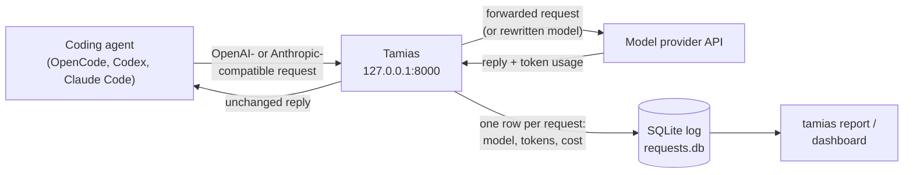
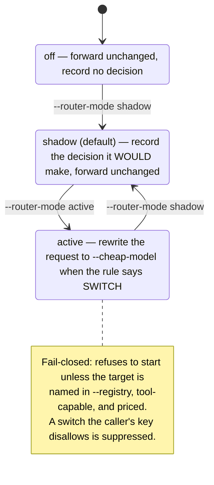
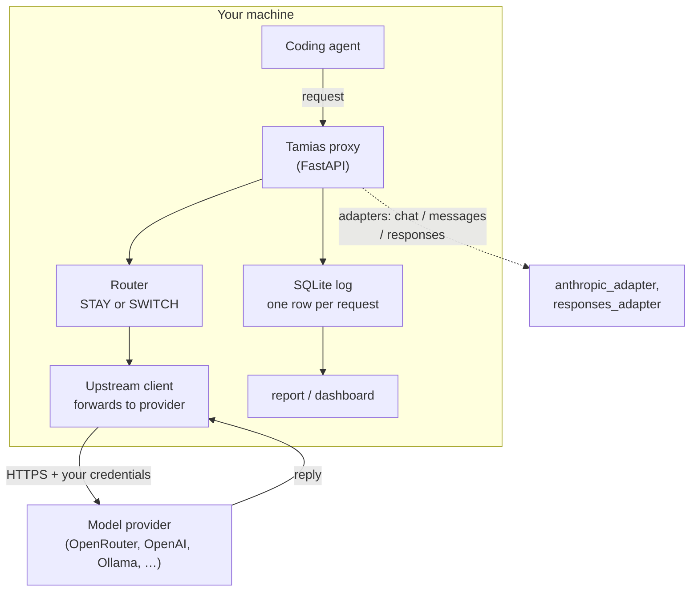

# Tamias

Tamias sits between your coding agent and the model API and shows you, per
request, which model was used, how many tokens it cost, and how much money that
was. It can also send a request to a cheaper model instead, when a configured
rule says that is safe. Point your agent at it instead of at the provider, and
it records the traffic.

Under the hood it is a transparent, OpenAI-compatible *request-rewriting proxy*:
a local server that sits in front of the provider, passes requests through
unchanged by default, and can optionally rewrite which model handles a request.
It is stateless per request payload — it holds no conversation state — though a
bounded, in-memory session table keeps recent routing decisions so that
`--min-gap` *hysteresis* (a cool-down that stops the router flapping between
models on every request) can apply across a session. It *meters* token usage and
cost for every request, and it can rewrite which model handles a request.

**Coverage:** Tamias rewrites model selection for OpenAI-compatible agents on
`/v1/chat/completions` and `/v1/messages` (Anthropic Messages wire). Codex-style
`/v1/responses` traffic gets metering and cost visibility today, **zero**
rewriting.

**Savings are estimated, not yet measured.** No measured savings exist; every
dollar figure in this project is hypothetical. The single source of truth
(**SSOT**) for what Tamias is, what is **`PROVEN`** (verified by a command whose
output is recorded) and what remains unvalidated is
[`TAMIAS-SSOT.md`](TAMIAS-SSOT.md) — read it before citing anything here.

> **Words used in this README.** *Proxy*: a local server between your agent and
> the provider. *Metering*: recording the tokens and cost of each request.
> *Shadow*: deciding what the router would do without changing the request.
> *Two-key act*: an action that needs two independent flags, so neither can be
> flipped by accident. *UNKNOWN*: a cost that could not be computed (a missing
> rate or token count), which is never guessed as `$0.00`.

## Requirements

- **Python 3.11 or newer** (this is the floor declared in
  [`pyproject.toml`](pyproject.toml); CI runs 3.11 through 3.14).
- No service or database to install — the log is a local SQLite file.

## Install

Tamias is on PyPI as `tamias`:

```sh
python -m venv .venv
source .venv/bin/activate        # Windows: .venv\Scripts\activate
pip install tamias
tamias --version                 # prints: tamias 0.1.0a8
```

Every release so far is a **pre-release** (`0.1.0aN`). Plain `pip install tamias`
works because PyPI holds no stable version yet: per pip's rule, pre-releases are
used when no stable version satisfies the requirement. Once a stable `0.1.0` is
published, later `0.1.1aN` pre-releases are hidden from a plain install and need
`pip install --pre tamias`. To pin exactly:

```sh
pip install tamias==0.1.0a8
```

To install the reviewed source from this checkout instead:

```sh
git clone https://github.com/kr1shnac/tamias
cd tamias
python -m venv .venv
source .venv/bin/activate        # Windows: .venv\Scripts\activate
pip install .
tamias --version                 # prints: tamias 0.1.0a8
```

> `pip install tamias` installs the current release from
> <https://pypi.org/project/tamias/>.

Signing company policies needs the optional `manifest` extra (Ed25519 signing
via `cryptography`):

```sh
pip install '.[manifest]'
```

To run the test suite and linter (contributors), install the `dev` extra — it
adds pytest and ruff, which a normal install does not need:

```sh
pip install -e '.[dev]'
```

## Quickstart



Tamias is transparent: the agent keeps speaking its own protocol and gets the
provider's reply untouched. Tamias records what each request cost on the way
through.



<details><summary>Text version of the diagram</summary>

Agent → Tamias (127.0.0.1:8000) → provider; the provider's reply comes back
unchanged; each request writes one row (model, tokens, cost) to the SQLite log,
which `tamias report` and the dashboard read.

</details>

Fetch a price sheet, check the local setup, then start the proxy (with the venv
from [Install](#install) still activated):

```sh
tamias prices fetch --out prices.toml
tamias doctor --prices prices.toml
tamias serve --upstream https://your-provider.example --prices prices.toml --db requests.db
```

Point your agent's base URL at `http://127.0.0.1:8000` instead of the provider,
and its traffic flows through the proxy.

`tamias doctor` is offline by default. Add `--online` only when you want its
short, timed upstream reachability check. It warns for a missing
`OPENROUTER_API_KEY` without showing its value, and it exits **0 when ready**
and **1 when a blocking check fails** (unsupported Python, an unwritable log
directory, or a busy port); WARN lines do not change the exit code. When no
`--prices` is given it reports the bundled snapshot rather than warning about an
absent `prices.toml`, matching what `serve` will actually price with.

Run one agent command through a temporary local proxy with `tamias run`:

```sh
tamias run -- your-agent
```

`--prices` defaults to `./prices.toml`, then `~/.tamias/prices.toml`, and,
failing both, the OpenRouter snapshot bundled inside the package. Falling back
to the bundle prints a provenance warning on stderr and prices against a dated
snapshot, so run `tamias prices fetch --out prices.toml` for current rates.
Naming an explicit `--prices` path that does not exist is still an error (exit
code 2):

```text
no price sheet found; run: tamias prices fetch --out ./prices.toml
```

`--upstream` defaults to `$TAMIAS_UPSTREAM` when that variable is set and to
`https://openrouter.ai/api` otherwise. Both flags still override the defaults:

```sh
tamias run --prices prices.toml --upstream https://your-provider.example -- your-agent
```

As with `tamias serve`, the upstream is a base URL without
`/v1/chat/completions`. `tamias run --help` prints the same defaults.

### Configuration file

Instead of repeating flags, put them in `~/.tamias/config.toml` (or the path in
`$TAMIAS_CONFIG`, or `--config PATH`):

```toml
provider = "openrouter"   # openrouter | openai | ollama
prices = "prices.toml"
db = "requests.db"
router_mode = "shadow"    # off | shadow | active
cheap_model = "some-cheap-model"
host = "127.0.0.1"
port = 8000
```

`provider` fills `upstream` from a built-in preset when no explicit URL is set.
Precedence is **CLI flag > environment > config file > built-in default**, and
the file holds no secrets — keep bearer tokens in `$TAMIAS_AUTH_TOKEN`. Inspect
what will be read:

```sh
tamias config path        # which file is used
tamias config show        # the values it holds
tamias config providers   # the built-in upstream presets
```

Provider presets also work directly on the command line:

```sh
tamias serve --provider openai --prices prices.toml --db requests.db
```

Use `tamias agent-config` to print a local configuration snippet for an agent:

```sh
tamias agent-config codex --port 8000 --project example
```

The `--project example` prefix scopes the local endpoint under `/p/example`.
`tamias run --project example` applies the same project prefix.

View a local run with:

```sh
tamias dashboard --db requests.db --prices prices.toml
```

`tamias serve` takes `--upstream`, `--prices`, and `--db` (each with an
environment or config-file fallback; see Configuration above). Its remaining
flags are grouped below:

| Purpose | Flags |
| --- | --- |
| Routing | `--router-mode`, `--router-profile`, `--router-config`, `--cheap-model`, `--strong-model`, `--min-gap` |
| Reasoning effort | `--effort-mode`, `--effort-style`, `--registry` |
| Usage and cost | `--inject-usage`, `--request-usage-cost` |
| Security | `--auth-token`, `--keys-db`, `--tls-cert`, `--tls-key`, `--allow-non-loopback` |
| Limits | `--max-body-bytes`, `--max-concurrency` |
| Policy manifest | `--manifest`, `--manifest-key` |
| Other | `--provider`, `--port`, `--host`, `--verbose` |

Run `tamias serve --help` for the authoritative list and defaults.

Give `--tls-cert` and `--tls-key` together to serve HTTPS; the startup banner
then prints the `https://` URL. TLS is independent of `--auth-token`, which a
non-loopback bind still requires.

Binding to a non-loopback `--host` is a **two-key** act (two independent flags
must agree): `serve` refuses to start unless you pass `--auth-token` (or set
`$TAMIAS_AUTH_TOKEN`) or configure company keys with `--keys-db`, **and** you
pass `--allow-non-loopback` to acknowledge the wider bind. Authentication alone
does not lift the refusal.
The token is checked as a bearer credential in
constant time,
and every response carries a `WWW-Authenticate: Bearer` header on a 401. The
token comes from `--auth-token`, `$TAMIAS_AUTH_TOKEN`, or a file named by
`$TAMIAS_AUTH_TOKEN_FILE` (contents trimmed of the trailing newline) — prefer
the environment or the file: a token on the command line is visible in `ps`,
shell history and CI logs, and `serve` warns when it sees one passed as a flag.
The three limits are also settable through the environment — `TAMIAS_AUTH_TOKEN`,
`TAMIAS_MAX_BODY_BYTES` (default 10 MiB, larger bodies are rejected with 413),
and `TAMIAS_MAX_CONCURRENCY` (default 64). The log database can be trimmed with
`tamias prune --db requests.db --keep-days 30` (`--keep-rows` and `--dry-run`
are also available); `tamias doctor` warns once the database passes 500 MB.
`tamias --version` prints the single version shared by the package and the
installed metadata.

`--keys-db` turns on **company keys**: per-caller tokens minted with
`tamias admin key issue` that carry a project and an optional model
allowlist. A key is checked before the request is forwarded or logged; an
unknown or revoked token gets 401, and a restricted key gets 403 for any
model it does not list. The key's project overrides a client-supplied
project header. Key auth is off unless `--keys-db` is given. This layer is
identity only - it does **not** cap spend; see [`docs/KEYS.md`](docs/KEYS.md).


## Routing

Routing decides, per request, whether to leave the model alone or send the work
to a cheaper one. It has three modes:



`off` and `shadow` never change what the provider runs, so the default install
cannot alter your traffic. `active` rewrites the request
to `--cheap-model`, and is opt-in and fail-closed: the process refuses to
start unless that model is named, listed in `--registry`, marked
tool-capable there and priced by the sheet, and a switch the caller's key does
not allow is suppressed rather than refused. The effort axis is separate
and off by default: `--effort-mode meter` records the effort the policy would
have chosen without changing the request, and `--effort-mode apply` sends it,
but only for a model listed in `--registry` (a capability catalogue); a level
a model does not list is downgraded to one it does. `--effort-style` chooses
OpenRouter's `reasoning.effort` field or OpenAI's `reasoning_effort` field.
The log records the requested setting; it does not prove the provider applied
it.


If an agent's tools return `Error: ...`, configure `error_markers`; see
[`examples/router.example.toml`](examples/router.example.toml).

## How it works



One request, end to end: the proxy parses the request, the **router** records a
`STAY` or `SWITCH` decision, the **upstream client** forwards it (rewriting the
model only in `active` mode), and one row is written to the **SQLite log** with
the tokens and computed cost. The provider's reply is returned to the agent
unchanged. A per-route adapter supplies metering for the Anthropic Messages and
OpenAI Responses wire formats. See
[`docs/audit/HOW-IT-WORKS.md`](docs/audit/HOW-IT-WORKS.md) for the full
walkthrough.



The `.mmd` sources and rendered `.png`/`.svg` for all three diagrams live in
[`docs/diagrams/`](docs/diagrams/).

## Status

- Metered: tokens and cost are recorded per request; cost is exact or UNKNOWN,
  never guessed.
- Routed: model switching is rule-based. Optional effort switching is fixture
  tested only; provider behaviour remains unverified.
- Tested on fixtures only: live provider behaviour and real Codex and Claude
  Code traffic are unverified.
- Evidence: dry runs on free models with simulated prices. **The two arms did
  different amounts of work, so their totals are not comparable in either
  direction**, and every dollar figure shown is hypothetical — the real billed
  cost of the free models is `$0`. Treat any percentage you see anywhere in this
  project as an illustration, not a measurement; see
  [`docs/audit/claims.md`](docs/audit/claims.md).

## Client matrix

Three client protocols are priced. Any other path is relayed unpriced, but each such request is still counted (one `route="passthrough"` row with no tokens and no cost, shown by `tamias report`).

| Client protocol | Route | Streaming | Buffered |
| --- | --- | --- | --- |
| OpenAI Chat Completions | `POST /v1/chat/completions` | metered | metered |
| Anthropic Messages | `POST /v1/messages` | metered | metered |
| OpenAI Responses | `POST /v1/responses` | metered | metered |
| Anything else | `/{path}` | relayed, count-only | relayed, count-only |

## Capability matrix

| Capability | Alpha state |
| --- | --- |
| Per-request token and cost log | Yes |
| Rule-based shadow routing | Yes — records decisions, does not rewrite |
| Active routing (request rewriting) | Opt-in — `--router-mode active`; refused at startup unless the target is in `--registry`, tool-capable, and priced |
| Reasoning-effort switching | Metering only; provider behaviour unverified |
| Proxy authentication | Opt-in bearer token; required off loopback |
| Company keys (identity + model allowlist) | Yes — opt-in via `--keys-db` |
| Per-key budget, model sub-caps, RPM/TPM | Yes — enforced by the gateway; **live behaviour UNTESTED**, see `docs/BUDGET.md` and `docs/RELEASE-STATUS.md` |
| Signed policy manifest (company policy) | Opt-in — `serve --manifest`; verified at startup and served at `GET /policy`, `docs/MANIFEST.md` |
| Prompt / response text storage | No — never stored |
| Multi-user or remote hardening | Not supported — single user |

## What Tamias does not do

- It does not proxy arbitrary web traffic: only the three routes above are
  metered; everything else is passed through counted-only (one
  `route="passthrough"` row with no tokens and no cost), never priced.
- It does not store prompt or response text, and it does not log credentials.
- It does not authenticate with the upstream provider; it forwards the
  credentials the client already sends.
- It does not rewrite provider requests unless `--router-mode active` is given
  and the target passes every startup gate, so by default it cannot change
  which model a provider actually runs.
- It does not prove that a provider honoured a requested reasoning effort; the
  log records the request only.
- It does not force a running agent to obey a served policy; it verifies and
  serves one. An agent still has to fetch it and apply it. See
  [`docs/MANIFEST.md`](docs/MANIFEST.md).
- It does not promise that a remaining budget is exact. A key's spend is
  reserved as a flat per-request ceiling and settled at the request's real cost,
  so the request that exhausts a budget can overshoot it by at most
  `actual - ceiling`, and a budget smaller than one ceiling admits nothing. See
  [`docs/BUDGET.md`](docs/BUDGET.md).


## Repository layout

```text
tamias/
├── src/tamias/        the package: proxy, router, pricing, store, CLI (22 modules)
├── tests/             the suite (1011 tests) plus mock upstreams
├── docs/              topic guides, audits, and the per-route reference
├── demo/              the two-arm demo scripts, runbook, and captured runs/
├── examples/          example router config (router.example.toml)
├── scripts/           maintenance tools: live check, reconciliation, benchmark
├── prices.*.toml      price sheets used by tests and docs (see below)
├── TAMIAS-SSOT.md     the design spec and single source of truth
├── AGENTS.md          instructions for coding agents working in this repo
├── CONTRACT.md        the proxy's interface contract, in brief
├── CHANGELOG.md       release history (Keep a Changelog format)
├── CONTRIBUTING.md    how to set up and gate a change
├── SECURITY.md        how to report a vulnerability
└── README.md          this file
```

The four `prices.*.toml` sheets at the root are deliberately kept there: the
tests and the demo read them by repo-root path. `prices.example.toml` is the
starter template; `prices.simulated.toml` and `prices.openrouter-sim.toml` are
fixtures; `prices.openrouter.toml` is a real snapshot.

## Documentation

**Precedence.** On what Tamias *is* and what is claimed, `TAMIAS-SSOT.md`
outranks every other document here. On what the *code* actually does,
[`docs/audit/claims.md`](docs/audit/claims.md) outranks the SSOT. When they
disagree, the code-truth ledger wins for behaviour and the SSOT wins for intent.

- [`TAMIAS-SSOT.md`](TAMIAS-SSOT.md) — **the single source of truth** (Design
  Spec v1.1). On what Tamias *is*, it outranks every other document here.
- [`docs/ARCHITECTURE.md`](docs/ARCHITECTURE.md) — a short pointer: the
  cache-semantics detail that is still current, plus a map of where each topic
  now lives. The full frozen v1.2 architecture (2026-09-30) is archived verbatim
  at [`docs/ARCHITECTURE.legacy.md`](docs/ARCHITECTURE.legacy.md), superseded on
  product identity by the SSOT. The code implements a subset of it;
  [`docs/RELEASE-STATUS.md`](docs/RELEASE-STATUS.md) records which parts exist
  and which do not.
- [`docs/ROUTING.md`](docs/ROUTING.md) — the router's matcher, profiles and
  TOML keys.
- [`docs/PRICING.md`](docs/PRICING.md) — how token counts become a dollar
  figure, and when the answer is UNKNOWN.
- [`docs/EFFORT.md`](docs/EFFORT.md) — optional reasoning-effort switching.
- [`docs/BUDGET.md`](docs/BUDGET.md) — per-key budgets, model sub-caps and rate
  limits (enforced by the gateway; live behaviour UNTESTED).
- [`docs/KEYS.md`](docs/KEYS.md) — company keys: per-caller identity and model
  allowlists (identity only, not spend caps).
- [`docs/MANIFEST.md`](docs/MANIFEST.md) — signed policy manifests: a company
  policy the gateway verifies and serves at `GET /policy`.
- [`docs/PLATFORMS.md`](docs/PLATFORMS.md) — supported Python and OS, and the
  Windows database-permission caveat.
- [`docs/PROVIDER-COST.md`](docs/PROVIDER-COST.md) — how OpenRouter's
  provider-reported `usage.cost` is captured as `provider_cost_usd` (the
  `--request-usage-cost` flag), and why NULL means UNKNOWN, never zero.
- [`docs/RELEASE-STATUS.md`](docs/RELEASE-STATUS.md) — what is built, what is
  published, and what is blocked.
- [`demo/RUNBOOK.md`](demo/RUNBOOK.md) — how to produce and read the two-arm
  demo, including its known limits.
- [`DEMO.md`](DEMO.md) — the demo script: three offline acts, exact commands,
  output captured on a real run.
- [`DEMO-LIVE.md`](DEMO-LIVE.md) — the paid-run procedure (the live demo),
  kept separate because it spends real money and needs an owner decision.
- [`docs/OPENCODE.md`](docs/OPENCODE.md) — pointing OpenCode at Tamias.
- [`docs/OPENROUTER.md`](docs/OPENROUTER.md) — routing OpenRouter traffic
  through Tamias.
- [`docs/DASHBOARD.md`](docs/DASHBOARD.md) — the local web dashboard.
- [`docs/ROUTES.md`](docs/ROUTES.md) — every HTTP route Tamias serves and
  whether it rewrites, meters or passes through.
- [`docs/LIVE_CHECK.md`](docs/LIVE_CHECK.md) — the live check to run before
  trusting the log.
- [`docs/BILLED-COST.md`](docs/BILLED-COST.md) — OpenRouter's billed-cost
  lookup, from the linked provider documentation only.
- [`docs/audit/HOW-IT-WORKS.md`](docs/audit/HOW-IT-WORKS.md) — the lifetime of
  one request, end to end.
- [`docs/audit/claims.md`](docs/audit/claims.md) — the verified-claims ledger:
  what the code does, tagged VERIFIED/SUPERSEDED/UNVERIFIED. On code truth it
  outranks the SSOT.
- [`docs/live-evidence.md`](docs/live-evidence.md) — captured evidence from the
  live checks (no real key material).

**Contributing and policy:** [`CONTRIBUTING.md`](CONTRIBUTING.md),
[`SECURITY.md`](SECURITY.md), [`SUPPORT.md`](SUPPORT.md),
[`CODE_OF_CONDUCT.md`](CODE_OF_CONDUCT.md), [`CHANGELOG.md`](CHANGELOG.md).
